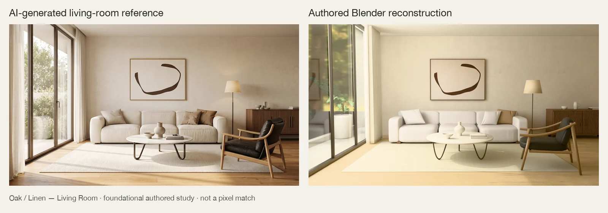
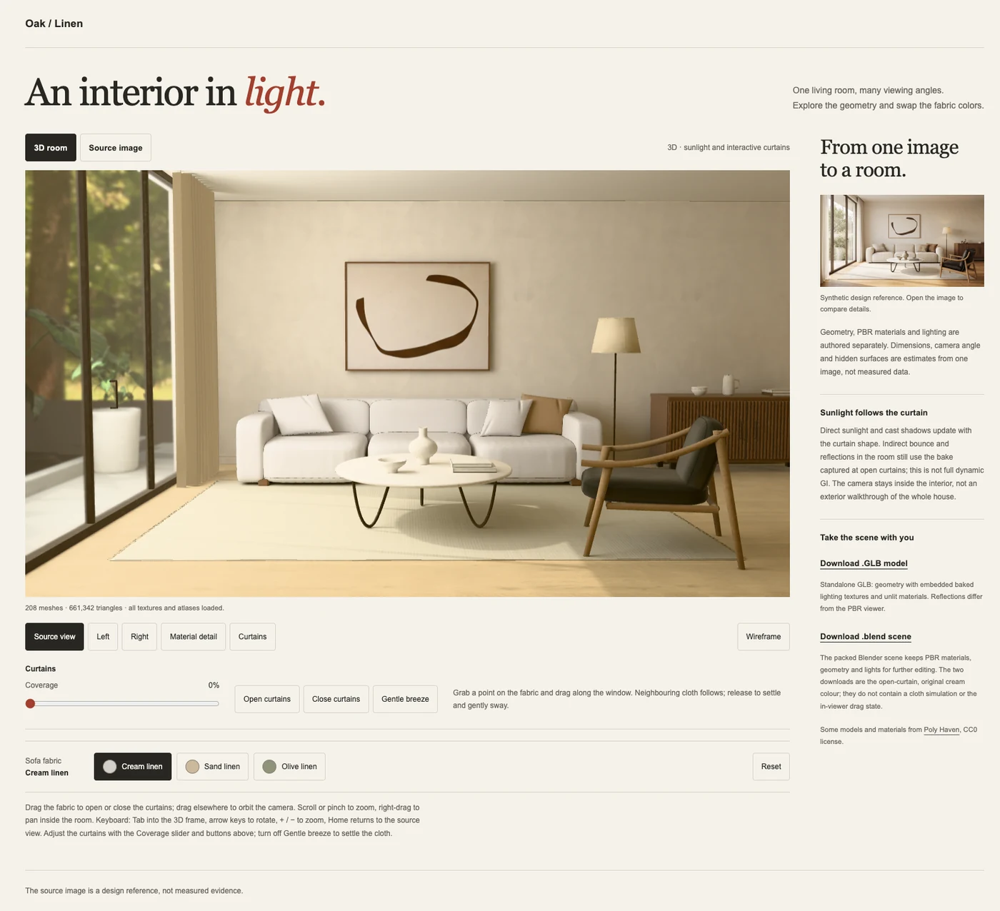

# Showcase — Oak / Linen Living Room

These previews are bundled with the skill so anyone with the public package or public source can open them locally. Open this file in a Markdown viewer or ask the agent to open the adjacent WebP images. The landing-page README uses the identical images from the separately hosted [public media repository](https://github.com/img2threejs/img2interior-media). An actual interactive viewer of the same authored scene is hosted at [img2threejs.io/living-room/](https://img2threejs.io/living-room/); the README links to that live demo. The first image below is the **native Blender render** (reference + reconstruction) and the second is an **archived screenshot of the browser viewer** — they are different products, both included for offline review.

## Reference → editable native scene

**Left:** the approved AI-generated design reference, not a photograph or measured survey. **Right:** a real render after reopening the packed Blender deliverable in a separate consumer session. The previews were resized/compressed and labeled, not AI-retouched or relit for presentation.

## Working browser project

This is an **archived browser screenshot** of the working Three.js project — not a public live demo and not the native render (the first image above is the native comparison; this one is the browser view). Visible download controls refer to that project; no Blender/GLB downloads are published with this gallery. The live, interactive version of the same viewer lives at [img2threejs.io/living-room/](https://img2threejs.io/living-room/).

## What this example establishes

This is the **original Oak / Linen living-room research study** whose scene-specific authoring was extracted into the packaged recipe and whose observed repairs informed the [workflow lessons](../../reference/showcase-lessons.md). It used actual Blender/Python geometry, PBR preparation, baking/export and project-specific Three.js integration. These previews do not represent a new execution of the packaged 0.3.0 skill or the README's revised prompt. Version 0.3.0's licensing/documentation revision is not a rendering-quality upgrade.

The case is intentionally source-specific. Its recipe is guarded by the original reference hash; a different room needs newly authored geometry and materials, not this living room reused as a fallback. See the [recipe boundary](../../reference/oak-linen-recipe.md).

## Limits

- Framing, room proportions, sofa/pillow forms, fabric folds and lighting differ from the reference. Single-view dimensions, unseen surfaces, material properties and the garden were authored estimates.
- Baked indirect lighting and the environment probe remain based on open curtains. Curtain interaction is approximate and does not rebake global illumination.
- The portable GLB has a static baked appearance; macro fabric detail and transmission differ from native/runtime materials. It does not carry live curtain physics or sofa-color state.
- The original study is a large research payload, not a lightweight deployment benchmark. Desktop and emulated narrow-viewport captures do not certify physical phones, arbitrary hardware or production networks.
- Example-specific counts, material settings and acceptance measurements are not universal quality thresholds. Passing structural/export checks does not establish visual fidelity for a new image.

Only two optimized documentation images are bundled here. Full-resolution references, native/GLB assets, textures and production reports remain outside the package; they are not required to read this skill. Third-party content retains its own terms; see the [license](../../LICENSE). Public previews grant no rights to any user's project assets.
